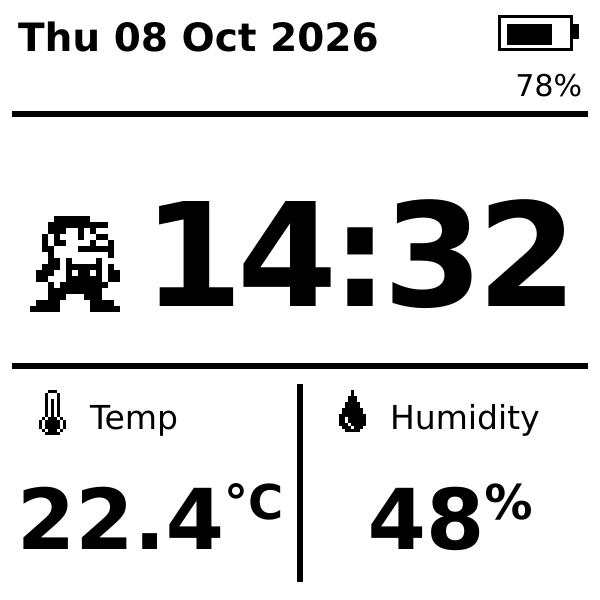

# MicroPython e-paper clock — Waveshare ESP32-C6-ePaper-1.54

Custom MicroPython firmware for the [Waveshare ESP32-C6-ePaper-1.54](https://docs.waveshare.com/ESP32-C6-ePaper-1.54)
that exposes the board support package (BSP) as a MicroPython module (`import bsp`) and runs a
low-power, asyncio-based clock:



- **Face:** date, time, temperature, humidity (on-board SHTC3), battery status, pixel-art plumber.
- **Every 2 minutes:** wake, read time and sensors, refresh the e-paper, deep sleep again.
  A full refresh is done every 30 wakes (hourly) to clear ghosting; otherwise partial refresh.
- **NTP once a day at noon** (first wake at/after 12:00 local; retries every 10 min until 13:00).
  Wi-Fi is only switched on for that sync. Bluetooth, audio, SD and the LED are never powered.
- **Time keeping:** the battery-backed PCF85063 RTC holds UTC; the display shows local time.
- **State** that must survive deep sleep is kept in RTC memory (no flash writes).

## Repository layout

```
firmware/boards/WAVESHARE_C6_EPAPER_154/  MicroPython board definition (16 MB flash, frozen manifest)
firmware/modules/bsp/                     `bsp` C module: ported Waveshare BSP drivers + bindings
python/                                   clock application (frozen into the firmware)
  app.py  main.py  config.py  persist.py
  hw/          board.py (power policy)  battery.py  sleep.py (deep sleep / dev mode)
  net/         wifi.py  ntp.py (asyncio SNTP)
  timekeeping/ clock.py (RTC + NTP policy)  tz.py (UTC offset + DST)
  sensors/     climate.py (SHTC3)
  ui/          display.py (async e-paper)  clock_face.py  writer.py  icons.py  fonts/
  apptypes.py  shared type aliases (see Typing)
stubs/bsp/    type stubs for the `bsp` C module
scripts/      build.py  flash.py  deploy.py  typecheck.py  idf_env.py  (+ build.sh / build.ps1 wrappers)
tools/        make_icons.py  make_fonts.py  make_mockup.py  icon_art.py
tests/host/   host tests (CPython) with stand-ins for MicroPython-only modules
patches/      micropython-windows-build.patch (applied on Windows only, see below)
third_party/  micropython (v1.29.0, git submodule)
              waveshare (BSP reference, not tracked; optional:
              git clone https://github.com/waveshareteam/ESP32-C6-ePaper-1.54 third_party/waveshare)
```

## Requirements

- **ESP-IDF v5.5.x** installed locally (Windows or Linux; no Docker). The build uses the IDF you
  point it at and its own Python environment.
- Python 3.9+ and git on the host.
- Host tools: `pip install -r requirements-dev.txt` (prebuilt `mpy-cross` 1.29, `mpremote`, Pillow).

```sh
git clone --recurse-submodules <this repo>     # or: git submodule update --init
pip install -r requirements-dev.txt
```

## Build

Windows (PowerShell or cmd):

```powershell
python scripts\build.py --idf-path C:\esp\Espressif\frameworks\esp-idf-v5.5.5
# or: .\scripts\build.ps1 --idf-path ...   or set IDF_PATH and omit --idf-path
```

Linux:

```sh
./scripts/build.sh --idf-path ~/esp/esp-idf      # or export IDF_PATH=... first
```

Options: `--test` (run host tests first), `--typecheck` (mypy, see below), `--clean`, `--regen-assets` (icons, fonts, mockup),
`--no-submodules`, `--verbose`, `--allow-any-idf`. Output: `build/WAVESHARE_C6_EPAPER_154/firmware.bin`
(single image, flashed at offset 0x0).

What the script does: initialises the submodules → checks the IDF is v5.5.x → gets the IDF
environment from `idf_tools.py export` (with the IDF's Python env, no shell export script needed)
→ uses the pip `mpy-cross` → builds MicroPython's esp32 port with this board, the `bsp` C module
and the frozen app → assembles `firmware.bin`.

**Windows note:** upstream MicroPython only supports building the esp32 port on Linux/macOS/WSL,
because its qstr generation uses command lines longer than the Windows limit (32K chars) plus
`cat`/`sed`/`touch`. On Windows, `build.py` applies `patches/micropython-windows-build.patch`
to the submodule (response files + a Python replacement for the shell pipeline). On Linux the
submodule is used unmodified.

## Flash and set up

```sh
python scripts/flash.py --port COM5            # Linux: --port /dev/ttyACM0 ; add --erase for a clean flash
python scripts/deploy.py --port COM5 secrets --ssid MyWifi --password secret
```

Set your time zone in `python/config.py` (`TZ_OFFSET_MIN`, `DST_RULE` = `"EU"`, `"US"`, `"IL"` or
`None`) and rebuild — or copy the edited `config.py` to the board's filesystem
(`mpremote cp python/config.py :config.py`), which takes precedence over the frozen one.

### Getting to the board while it deep-sleeps

In deep sleep the USB port disappears. Options:

- **Press PWR**: the board wakes into **dev mode** — it updates the screen and stays awake with the
  REPL on USB (no watchdog, no sleep). Run `machine.reset()` (or power-cycle) to go back to the
  clock cycle.
- `python scripts/deploy.py --port COM5 dev on` creates `/nosleep`: every wake stays awake
  (`dev off` removes it and resets).
- **Hold BOOT while plugging in USB** to enter the ROM bootloader for flashing.

`python scripts/deploy.py --port COM5 run` runs the app from the PC's `python/` folder
(mpremote mount) for quick iteration without reflashing.

## `bsp` module API

```python
import bsp
bsp.init()                         # shared I2C bus (SDA 18 / SCL 8) + TCA9554 expander

bsp.power.epd([on]) / audio([on]) / vbat_latch([on]) / led([on])   # get or set

bsp.epd.init()                     # SPI + GPIO setup (once)
bsp.epd.begin(full)                # start panel init (HW reset, LUT) - non-blocking
bsp.epd.show(new, old=None, full=False)  # write RAMs (5000 B, MONO_HLSB, 1 = black) + start refresh
bsp.epd.sleep()                    # start panel deep sleep
bsp.epd.poll() -> bool             # advance; True when idle  -> `while not poll(): await sleep_ms(10)`
bsp.epd.busy() -> bool; bsp.epd.WIDTH, bsp.epd.HEIGHT

bsp.shtc3.init() -> id; wakeup(); measure_start(); read() -> (temp_c, rh); sleep(); MEASURE_MS
bsp.rtc.init(); datetime([(Y, M, D, wd, h, m, s)]); valid() -> bool; ram([byte])   # UTC, wd 0 = Monday
bsp.battery.init(); voltage() -> V; percent([V]) -> 0..100
bsp.i2c.scan(); readfrom_mem(addr, reg, n); writeto_mem(addr, reg, buf)
bsp.PIN_BOOT_BUTTON, bsp.PIN_PWR_BUTTON
```

The C drivers are ports of the Waveshare example BSP (`11_FactoryProgram/components/port_bsp`):
same pins, init sequences and waveform LUTs, with these changes:

- Slow operations (BUSY waits, delays) run as a polled sequencer, so Python can `await` them.
- The TCA9554 and PCF85063 drivers are small built-in replacements for the managed components.
  MicroPython's build has no hook for extra IDF components, and the expander's `gpio_set_level`
  wrapper would clash with `machine.Pin`.
- No fixed −4 °C SHTC3 offset; it's configurable in `config.TEMP_OFFSET_C` instead.
- Don't create `machine.I2C(0)`: the board's I2C bus belongs to `bsp`.

## Typing

The Python code is fully annotated and type-checked with mypy (`strict`) against
**MicroPython's** stdlib and ESP32 stubs, not CPython's. For example, `asyncio.sleep_ms` and
`machine.Pin` are checked as they exist on the device. `stubs/bsp/` types the `bsp` C module.

```sh
python scripts/typecheck.py        # installs micropython-esp32-stubs 1.29 into .typings/ on first run
```

MicroPython parses annotations but never evaluates them, and has no `typing` module. Typing names
and the shared aliases in `python/apptypes.py` are therefore imported like this, at no cost on the device:

```python
try:
    from typing import Optional
    from apptypes import FaceValues
except ImportError:
    pass
```

## Tests and assets

```sh
python tests/host/test_app.py      # time zones, NTP policy, persistence, face rendering (PNG previews in tests/host/out)
python tools/make_icons.py         # tools/icon_art.py -> python/ui/icons.py
python tools/make_fonts.py         # DejaVu Sans -> python/ui/fonts/*.py (uses matplotlib's copy or --font-dir)
python tools/make_mockup.py        # docs/clock_face_mockup.svg
```

## To verify on hardware

Built and host-tested, not yet run on a board. Things to check first:

- LED polarity (schematic says active-low; `BSP_LED_ACTIVE_LOW` in `modbsp.c`).
- Partial refresh after the panel's power rail was off during sleep (if it misbehaves, set
  `EPD_POWER_OFF_IN_SLEEP = False`).
- Deep-sleep current, and that the VBAT latch keeps the board on through sleep on battery.
- `TEMP_OFFSET_C` calibration against a reference thermometer.
